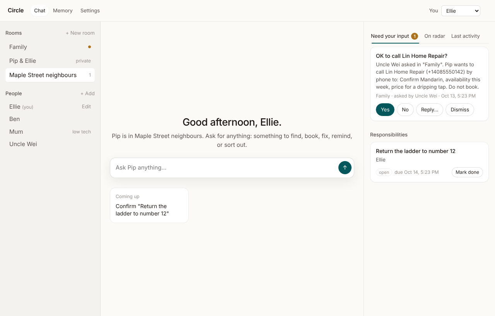
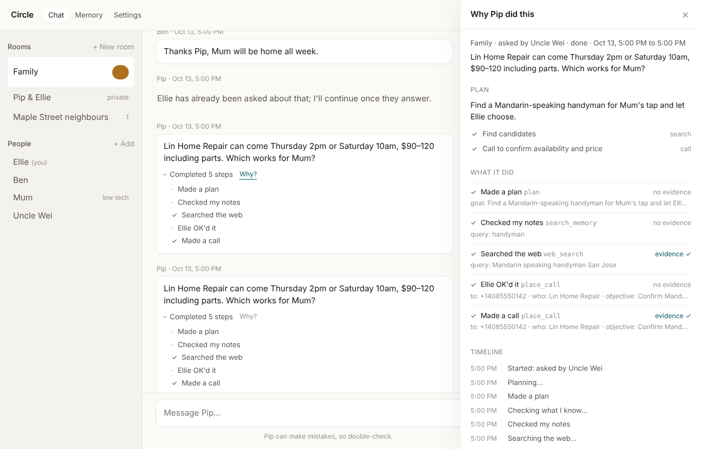
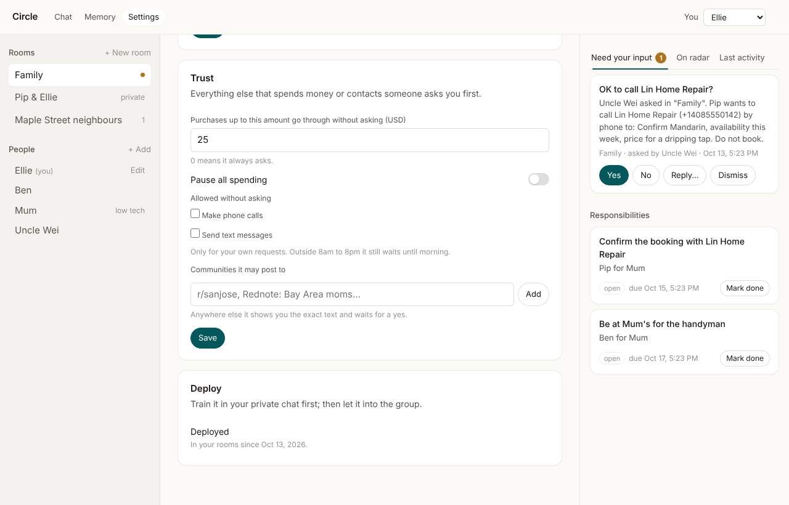
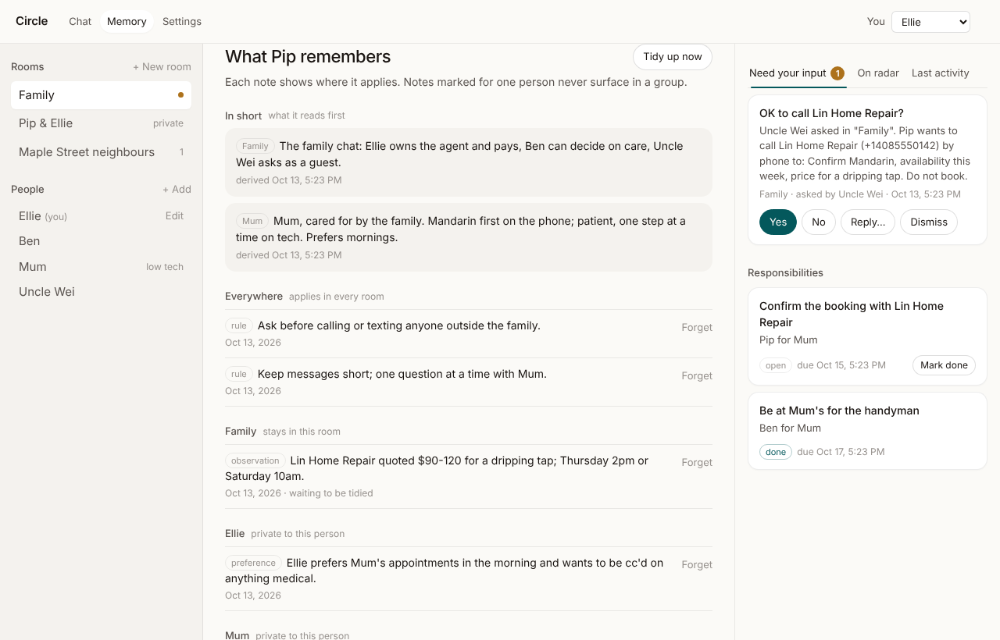

# Circle

A personal agent that lives in the group chats people already have: the family thread, the friends' group, the neighbourhood chat. One person trains and deploys it; everyone in the chat gets help without signing up for anything. It coordinates, follows through, and asks the right person when a decision, an approval or a private detail is needed.

This is a from-scratch build. Its design comes from three sources: a reverse engineering of Wajo's Fo ([docs/research/wajo-fo-build.md](docs/research/wajo-fo-build.md), [docs/research/wajo-fo.md](docs/research/wajo-fo.md), [docs/research/wajo-fo-client-report.md](docs/research/wajo-fo-client-report.md)), the public teardown of Instinct's memory, and what we wanted that neither does. The design note is [docs/design.md](docs/design.md).

## What it does

**Starts in a private chat.** A new agent is trained in the owner's own chat first: it asks what to hand off and how to behave, notes rules and people as memory, and will not contact anyone until it is deployed. Deploying needs a name, a purpose and a little training; the same check backs the Deploy button.

**Lives in the group.** The agent is added to an existing chat and answers when named, when a message is plainly a request within its purpose (a cheap yes/no from the small model), or when a question it asked is answered. People who never signed up are guests: they ask by name and get served; anything that needs the owner's accounts or money produces a card in the owner's own chat ("Uncle Wei asked in Family… OK to call Lee's Repairs?"), the group hears "I've asked Ellie to OK that", and the owner's yes finishes the job in the group.

**Looks after someone, as a group.** A room can mark a member as cared for and others as deciders. Every real-world item becomes a tracked responsibility with an owner and a time: the appointment, the ride, the repair visit, the prescription. The agent nudges owners the day before, reports in one line when things close or slip, and routes care decisions (including a call or text on the cared-for person's behalf) to a decider before the owner; money always stays with the owner. A responsibility nobody confirms after three reminders is escalated once as a decision card (reassign, drop, keep nudging). When the cared-for person asks directly, the agent switches to patient mode: one step at a time, their words, and it says who it will ask before asking. It teaches technology one step at a time and remembers where the person got stuck last time.

**Is resourceful.** For "find a Mandarin-speaking handyman" it keeps a plan with an approach ladder: search, ask the group, call candidates, ask a local community (Reddit or Rednote, only with a yes to the exact text), ask a specific person. When an approach stalls twice the next one is activated and the agent is told. It compares what it found and lets the requester choose before booking.

**Earns trust one notch at a time.** Every write asks first. The owner can allow specific tools, set a dollar amount under which purchases pass, pause spending, and pre-approve communities. Contacting a third party is disclosed (who, how, why); outside 8am to 8pm it is held until morning. Scheduled work carries the authorisation it was given and re-checks its premise before acting. Every tool call is stored with evidence; the reply's footer ("— 3 steps · 2 verified: Searched the web, Made a call") comes from those records, and a reply that claims an action with no record is corrected.

**Remembers the right things in the right places.** The agent only writes dated observations during a run; a background pass promotes them into typed memories, merges duplicates, rewrites corrected facts with their date, retracts what was taken back, and derives a short profile the agent reads first. What a group says stays with that group. What someone tells the agent privately never surfaces in a group.

## What it looks like

| | |
|---|---|
|  |  |
|  |  |

## Run it

```bash
bun install
cp .env.example .env     # add OPENROUTER_API_KEY (or ANTHROPIC_API_KEY) and whatever services you have
SEED_DEMO=1 bun run start
# open http://localhost:3000
```

What gets wired depends on `.env`:

| Setting | What it turns on |
|---|---|
| `OPENROUTER_API_KEY` | The model, through OpenRouter: `z-ai/glm-5.3` for the agent and `z-ai/glm-5.3-flash` for labels, premise checks and the memory pass. Override with `MODEL` and `MODEL_SMALL` (Claude ids work too: `anthropic/claude-opus-5.5`). |
| `ANTHROPIC_API_KEY` | The model directly from Anthropic: Claude Opus 5.5 and Haiku 5.5. |
| `PROJECT_ID`, `PROJECT_SECRET` | iMessage through Photon Spectrum. Each iMessage chat becomes a room; senders become people; the owner is recognised by the phone number on their person record (`PATCH /api/people/:id {phoneE164}`). |
| `BROWSERBASE_API_KEY` | The `browse_page` tool runs in a cloud browser. Without it, pages are read as text through Jina Reader. |
| `BRAVE_API_KEY`, `SEARCH` | `web_search` uses Exa's public endpoint by default (no key; the channel [Agent Reach](https://github.com/Panniantong/agent-reach) recommends, and it answers "Mandarin-speaking handyman San Jose" with names and phone numbers). A Brave key switches to Brave; `SEARCH=duckduckgo` uses the keyless scrape. |
| `CLERK_SECRET_KEY`, `CLERK_PUBLISHABLE_KEY` | Sign-in on the owner UI; every API call is made as the signed-in person. |

Without a model key the server still boots and the agent only acknowledges messages, so the UI can be explored.

Offline, with no key, the whole runtime runs against a scripted model:

```bash
bun run demo    # the handyman errand in a family chat, end to end
bun test        # 49 tests across the run loop, gates, care, planner, memory, timers, hands, eval
bun run eval    # six family errands played against the configured model, graded on stored state
bun run typecheck
```

## Layout

```
src/core        types, ids, clock
src/store       SQLite schema and repositories (bun:sqlite, FTS5 for memory)
src/model       ModelClient; Anthropic adapter; scripted model for tests
src/agent       agent spec defaults; system prompt assembly
src/memory      memory service (scopes, visibility, recall); nightly consolidation
src/rooms       rooms, members, roles, whose accounts a request may use
src/inbox       attention items (needs you) and the three home tabs
src/care        the responsibilities ledger and its nudges
src/planning    plans with an approach ladder and stall handling
src/tools       the tool registry (labels, gates) and the "hands" interfaces with fakes
src/runtime     the run loop: events with cursors, steering, gates, resume, footer
src/scheduler   schedules with authorisation and premise checks, staged outreach, heartbeat
src/channels    web server: JSON API, watch stream, owner UI
skills/         markdown procedures the agent reads when a task matches
web/            the owner's page: inbox, chat, memory, ledger
test/           offline tests with a scripted model and fake hands
```

## API in one screen

```
POST /api/rooms/:id/messages        {personId, text, dedupKey}   -> {run, session}
GET  /api/sessions/:id/watch?after=N  NDJSON: {event} lines, then {ping} with the cursor
GET  /api/inbox?personId&agentId     {needsYou, radar, inFlight, activity}
POST /api/attention/:id/resolve     {answer}                     resumes the waiting run
GET  /api/schedules | POST /api/schedules | POST /api/schedules/:id/pause
GET  /api/commitments?roomId
GET  /api/memory?agentId | POST /api/memory | DELETE /api/memory/:id | POST /api/memory/consolidate
POST /api/agents/:id/deploy          ends training (409 with a reason when not ready)
GET  /api/suggestions?agentId        "want me to…" cards mined from the ledger and schedules
POST /api/commitments/:id            {status}                     mark a responsibility done, dropped, blocked
GET  /api/profiles?agentId           derived summaries per scope
POST /api/tick                       run the scheduler once
```

## Starting a fresh repository

This tree shares no code with what came before it. To move it into a brand-new repository with clean history:

```bash
git checkout --orphan main && git commit -m "Circle" && git remote set-url origin <new-repo-url> && git push -u origin main
```

## Status

Built: training before deployment; rooms with roles and guest serving; patient mode and decider-first care approvals; escalation of stuck responsibilities; proactive suggestions; the run loop with gates, steering and resume; plans with the approach ladder; the responsibilities ledger with nudges; schedules with authorisation, premise re-check and working-hours holds; memory with scopes, privacy and consolidation; the owner UI with Clerk sign-in; the iMessage channel through Photon Spectrum; the browser hand through Browserbase; the model through OpenRouter (GLM 5.3) or Anthropic; web search through Exa and page reading through Jina Reader; an eval harness.

Internet reach: `web_search` and `browse_page` are real (Exa and Jina Reader, both keyless; Brave and Browserbase when keyed). The agent follows `skills/internet-reach.md`, adapted from Agent Reach's skill to the two tools it has; it says plainly which platforms it cannot read yet.

Not yet: telephony (calls in Mandarin need a voice vendor), reading or posting on Reddit and Rednote (both need a logged-in session); WhatsApp and Telegram channels; payments; voice chat. Each is an interface in `src/tools/hands.ts` or `src/channels/` with a fake you can swap. Postgres is not used: the store is one SQLite file.
