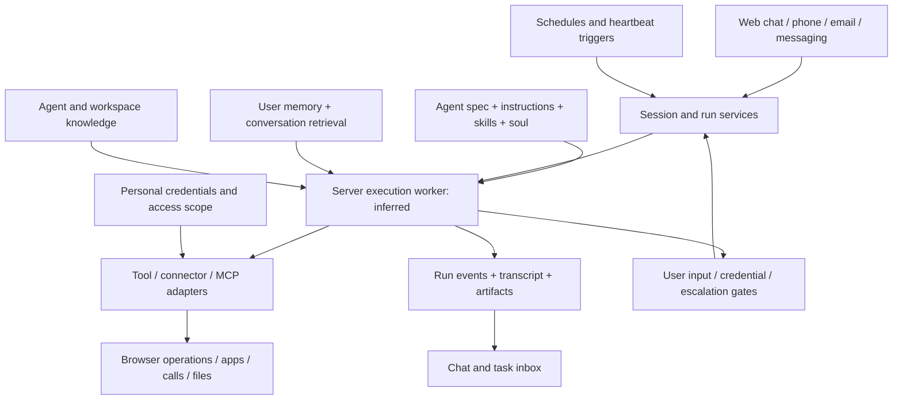

# How Wajo's personal agents are built (logged-in session report)

Ellie's own investigation of October 13, 2026, using her logged-in Chrome session and REA 6.4.0. Kept here verbatim as the third source behind [../design.md](../design.md), next to the bundle reconstruction ([wajo-fo-build.md](wajo-fo-build.md)) and the product map ([wajo-fo.md](wajo-fo.md)). The evidence ledgers, REA Evidence files and asset manifest it links to live on Ellie's machine under `~/wajo-research/`, not in this repository.

Where the two REA passes disagree on counts (320 chunks here against 458 in the bundle reconstruction), the difference is scope: this pass started from the scripts the logged-in page loaded; the other closed over every chunk the public landing page preloads.

---

**The strongest reconstruction is a configurable agent running in a durable session system, with personal context, credential-backed tools, communication channels, and scheduled work.** Much of the experience comes from the surrounding execution infrastructure: reconnecting to work, waiting for input, carrying authorization into future jobs, and keeping a task inbox. The frontend does not reveal Wajo's private server implementation.

This report distinguishes **live UI observations**, **static client code**, and **reconstruction choices**. It does not claim to recover Fo's private system prompt or exact model.

## What was inspected

- Logged-in Chrome: home suggestions and task tabs, personal settings, connections, permissions copy, schedules with stored job prompts, and an existing completed chat's tool-step display. No agent messages were submitted or scheduled jobs edited.
- Public scripts discovered from that rendered page and their literal JavaScript imports: 320 chunks, 3,536,766 bytes. Acquisition preserved URLs, hashes, and timestamps in the asset manifest.
- REA parsed all 320 files with zero parser failures, visited 959,123 AST nodes, and produced 10,255 findings. Full graph expansion hit result budgets. A second analysis selected 19 core chunks; all parsed, but the schema library's semantic pass exceeded the worker heap. Static facts were retained. Coverage is explicitly partial.
- REA traced the agent API module: 95 nodes, 111 edges, three terminal paths. A graph edge is static evidence, not proof of execution.
- Additional manual reads connected client schemas, reducers, UI text, tool labels, and API declarations.

## Reconstructed architecture

Solid components below are grounded in client contracts or UI. The internal worker loop and storage are inferred implementation choices.



The shipped frontend uses React and TanStack server-function machinery. Requests cross a generated `/_serverFn/` boundary; its client references versioned service APIs. The public chunk environment identifies a Vite production build and PostHog analytics. These are frontend observations, not evidence of a particular backend language or database.

The distinction between agent, session, run, schedule, attention item, and artifact matters. They have separate client contracts. A chat window is a view of those objects; it is not the entire agent lifecycle.

## 1. Agent configuration is layered

The shipped client projects an agent spec with identity, owner, project, sharing scope, tools, connectors, timezone, brand assets, email signature, setup manifest, and optional sandbox-source-agent reference. Visibility supports private, project, workspace, and public scopes. Local editability is derived from owner identity.

Prompt configuration is separate: `{ provider, model, effort, instructions }`. The instructions editor explicitly describes these as system instructions for chat and base instructions for tool invocations, with skills appended at runtime. Personality has a separate structured `soul`: identity, personality, values, operating principles, and optional scenarios, emotional intelligence, recovery behavior, proactive behavior, and communication templates. The tool catalogue includes `load_soul_document`. Voice settings are also distinct: voice ID, language, automatic language switching, first message, and voice/inbound/outbound instructions.

Implication: a reconstruction should treat instructions, capabilities, personality, and voice as separate configuration layers. Exact backend prompt assembly, soul loading frequency, and Fo's current configuration remain unknown. Provider/model/effort selectors exist, but the client gates them to Wajo staff email domains; the static menu does not establish which model Fo currently uses.

## 2. "Knowing you" has several distinct sources

| Scope | Recovered interface | What remains unknown |
|---|---|---|
| Personal user | Profile fields; per-user memory enable/read/edit/forget/events; `search_memory` | Memory extraction, consolidation, write policy, index |
| Agent | Agent-specific knowledge upload/ingest/download | Ranking and exact prompt insertion |
| Workspace | Files, links, notes, workspace context | Backend storage and retrieval algorithm |

Conversation history is another retrieval surface: `list_past_sessions` and `get_session_transcript`. Knowledge ingestion uploads files before an ingest request, supports URLs and pasted text, and displays chunk counts. The live home page displayed suggestions specific to the user's recent affairs; the client has suggestion-fetch, refresh, reorder and acceptance-ID contracts, plus a refill-watch/poll policy. The personalization is visible; the generator, source-selection policy, scoring, and refresh pipeline are not recovered.

## 3. Runs are resumable, interruptible, and visible in the background

Declared session operations include run, long-running run, watch, events, transcript, stop, and runnable checks. The composer sends a session ID, text, file references, workspace ID, client time, optional location and accepted suggestion ID. It reconnects through a watch operation using a cursor. The reducer handles text deltas, progress, agent state/activity, tool starts/ends, reset, reconnecting, errors, completion, and steering.

Recovered client mechanics: cursor tracking and duplicate/older-event rejection; run-busy retries and a separate watch recovery path; independent background watch and transcript reconciliation polling; server `activeRun` state used when reconciling optimistic UI; text input during busy work queued as a steer; client recovery budgets of 30 seconds idle, 95 seconds busy retry, 30 minutes watch recovery.

Inference: execution is managed outside the browser connection. The client architecture does not establish a queue vendor, event database, or any specific backend framework.

## 4. Waiting for the user is an execution state

`wait_for_user_input` is represented as a running tool. Its input supports a question, hint, text or OTP input, OTP length, and an answer source of the user or the agent's email channel. Pending input extends the client idle window to 11 minutes. Credential continuation adds a temporary optimistic "continuing" state and faster transcript polling.

```text
run → tool requires input → persist wait → show question/code card
    → receive answer or credential completion → continue run → reconcile transcript
```

## 5. Tools combine APIs, browser work, communication and artifacts

The client recognizes tools for Google mail/calendar/Drive, browsing, JavaScript execution, contacts, shopping, phone calls, scheduling, memory/history, document/image output, connectors and MCP (80 literal display entries extracted). Connections distinguish OAuth accounts, site logins, detail-based integrations, APIs and MCP. Site-login forms support password and email/SMS OTP variants. Browser-profile methods and debug browser-session artifacts are declared, suggesting retained remote browser state. An escalation service declares claim, ask-user, progress, follow-up, deadline and resolution operations; a human-call-request tool is also recognized. Service agents have a separate external-access allowlist for unauthenticated customers using the owner's credentials; this is service-agent configuration, not a claim about personal chats.

## 6. Schedules carry the task and its authorization context

The live schedules page showed planned and completed schedules with prompt text and edit/pause/delete controls. A stored schedule prompt was prefixed with an authorization record: the approved recipient, communication channel and purpose, the approval basis, an instruction to recheck the premise against current conversation/calendar/ledger state, working hours, and a fresh approval for recipients outside the recorded scope. Observed: the durable job prompt carries these constraints. Unknown: whether equivalent checks are also enforced in code.

A replica should store schedule intent, timezone, run time/cron, originating session, authorization scope and result, not merely send an isolated future chat message.

## 7. Channels surround the same agent product

Calls and iMessage/SMS/RCS from the linked number; the agent exposes an email address (`handle@wajo.ai`) and phone contact; a voice session links to a parent chat session. Browser Live Voice is microphone → Deepgram nova-3 transcription → ordinary text send → TTS of the reply, with phases listening, thinking and speaking. Phone calls have separate voice-runtime interfaces.

## What I would reproduce

1. Durable identity and state: AgentSpec, PromptConfig, Soul, VoiceConfig, UserProfile, Session, Run, RunEvent, Artifact, InputGate, Schedule and AttentionItem.
2. One reliable server worker loop: assemble applicable context → call model → dispatch authorized tools → record events/results → pause or finish. No inspected evidence requires a swarm of subagents.
3. Reconnectable observation: append events with cursors; expose run/watch/transcript; reconcile UI after interrupted connections and channel changes.
4. Personal capability resolution: choose credentials by user and scope; explicit approvals and resumable login/input flows.
5. Context retrieval: profile plus scoped user memory, session history and agent/workspace knowledge.
6. Future work: schedules and heartbeat jobs carry the originating intent, channel and authorization context, then report into the task inbox and conversation.
7. Channel adapters: web first; email/text/calls should resolve the agent, user and relevant session rather than creating unrelated personas.

## Questions answered and remaining limits

| Question | Result |
|---|---|
| How agent identity, instructions, personality and tools are configured | Substantially recovered client contracts |
| How chat, tool events, recovery and user input work | Substantially recovered client implementation |
| How future jobs and task queues are represented | Client contracts plus live examples recovered |
| How personal context and credentials are scoped | Interfaces recovered; backend algorithms unknown |
| How browser Live Voice works | Client pipeline recovered; TTS/phone providers unknown |
| Whether Wajo uses multiple backend subagents | Unresolved; bounded frontend search found no implementation |
| Fo's private prompt and active model | Unresolved |
| Backend language, database, planner framework, queue, browser vendor | Unresolved |
| Memory extraction and ranking; server authorization enforcement | Unresolved |

No backend source, authentication secrets or private prompts were recovered. Public API declarations were inspected as text; they were not replayed.
